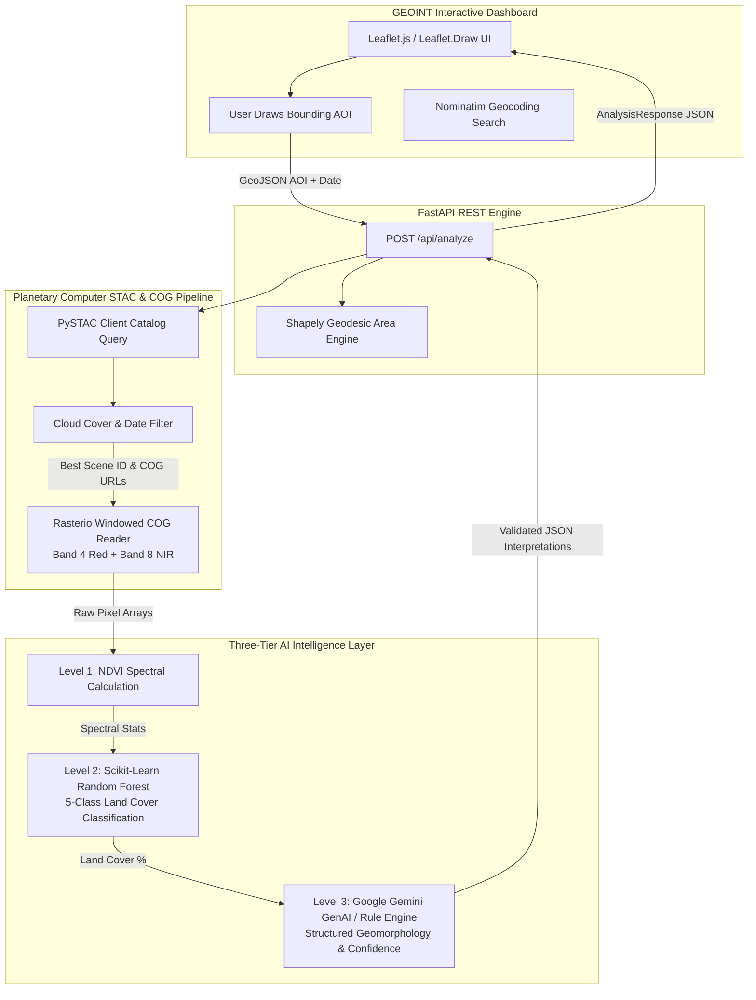

<div align="center">

# 🌍 GeoSentinel AI
### AI-Powered Earth Observation & ISR Geomorphological Intelligence Platform

[](https://www.python.org/)
[](https://fastapi.tiangolo.com/)
[-003366?style=for-the-badge&logo=esa&logoColor=white)](https://sentinel.esa.int/web/sentinel/missions/sentinel-2)
[](https://stacspec.org/)
[](https://scikit-learn.org/)
[](https://ai.google.dev/)
[](https://leafletjs.com/)

<p align="center">
  <strong>An automated, multi-tiered Geospatial Intelligence (GEOINT) and Remote Sensing analytical engine that transforms live multi-spectral satellite imagery into actionable terrain classification and geomorphological intelligence.</strong>
</p>

</div>

---

## 🎯 Executive Summary

**GeoSentinel AI** bridges the gap between raw **Earth Observation (EO) satellite streams**, **Geographic Information Systems (GIS)**, and **Artificial Intelligence**. Designed with principles derived from **Intelligence, Surveillance, and Reconnaissance (ISR)** workflows, the platform eliminates manual satellite data acquisition and heavy desktop GIS processing.

Instead, analysts can draw any **Area of Interest (AOI)** across the globe on an interactive tactical map, select a temporal baseline, and instantly trigger an automated ingestion pipeline:
1. **Real-time STAC Catalog Discovery**: Queries Microsoft Planetary Computer for open Sentinel-2 Level-2A surface reflectance data.
2. **Bandwidth-Optimized COG Extraction**: Performs HTTP range-requests on **Cloud Optimized GeoTIFFs (COGs)** to extract spectral bands ($B_{04}$ Red and $B_{08}$ Near-Infrared) strictly within the AOI boundary.
3. **Multi-Tiered AI Analysis**: Combines spectral physics index computations, local machine learning (**Random Forest ensemble classification**), and **Generative AI geomorphological reasoning** to deliver comprehensive landscape assessments with quantified confidence metrics.
4. **Ground-Truth Geological Research Ingestion**: Automatically queries the **OpenAlex** open catalog for the 4 most recent peer-reviewed geological, geotechnical, and remote sensing publications matching the AOI, surfacing titles, authors, DOIs, and Open Access PDF links.

---

## 🚀 Key Architectural Highlights

### ⚡ Sensor-to-Analyst Automation (STAC & COG Pipeline)
Traditional satellite analysis suffers from latency caused by downloading entire 10GB+ scene granules. GeoSentinel AI leverages **STAC API v1.0** specifications (`pystac-client`, `planetary_computer`) to query multi-spectral assets dynamically:
- **Cloud Cover Filtering**: Automatically isolates and ranks scenes below customizable cloud thresholds (`eo:cloud_cover < 40%`).
- **Windowed Raster Reading**: Utilizes `rasterio` windowed reading over HTTP to fetch exact pixel bounds from remote COG assets. This allows real-time execution even over bandwidth-constrained edge networks.

### 🧠 Three-Tier AI & Analytical Architecture
```
[ Level 1: Spectral Physics Engine ]  -->  [ Level 2: Local ML Classifier ]  -->  [ Level 3: GenAI Expert Interpretation ]
```

1. **Level 1 — Spectral Physics & Geodesic Engine**:
   - Calculates exact geodesic bounding box dimensions and true area in $\text{km}^2$ accounting for Earth curvature (`shapely`, geodesic algorithms).
   - Computes real pixel-by-pixel **Normalized Difference Vegetation Index (NDVI)**:
     $$\text{NDVI} = \frac{\text{NIR} - \text{Red}}{\text{NIR} + \text{Red}} = \frac{B_{08} - B_{04}}{B_{08} + B_{04}}$$
   - Extracts comprehensive statistical moments (`min`, `max`, `mean`, vegetation density ratios).

2. **Level 2 — Machine Learning Land Cover Classification (`scikit-learn`)**:
   - Employs a **Random Forest Classifier** trained over multi-spectral feature vectors (`[NDVI, Red Reflectance, NIR Reflectance]`).
   - Categorizes every pixel across five critical terrain classes: **Water**, **Bare Soil**, **Agriculture**, **Forest**, and **Urban/Built-up** environments.

3. **Level 3 — Generative AI Geomorphological Expert (`Google Gemini`)**:
   - Synthesizes quantitative metrics, geographic coordinates, and classification distributions into structured prompt engineering.
   - Outputs **expert-level geological, structural, and geomorphological interpretations** (e.g., bedrock exposure, dendritic drainage systems, fault/lineament likelihood, alluvial terrace formations) formatted strictly as validated `pydantic` JSON schemas.
   - **Tactical Resilience & Graceful Degradation**: Features an autonomous fallback rule engine that utilizes spectral heuristics if cloud APIs or edge network connections are offline.

---

## 🛰️ Relevance to ISR & Defense Applications

GeoSentinel AI is built with architectural patterns and workflows directly applicable to **Defense, Earth Observation, and ISR (Intelligence, Surveillance, and Reconnaissance)** engineering environments:

| C4ISR / EO Requirement | GeoSentinel AI Implementation |
| :--- | :--- |
| **Rapid Target Characterization** | Enables operators to instantly box remote coordinates and obtain immediate breakdown of foliage cover, bare soil exposure, and urban density without manual preprocessing. |
| **Edge & Low-Bandwidth Readiness** | By leveraging Cloud Optimized GeoTIFF (COG) HTTP range requests (`GDAL/Rasterio`), the system downloads megabytes of windowed pixels rather than gigabytes of raw scene files. |
| **Multi-Sensor Fusion Architecture** | Modular backend service boundaries (`backend.services.satellite` and `backend.services.engine`) allow seamless future ingestion of **SAR (Synthetic Aperture Radar / Sentinel-1)** for all-weather, day/night reconnaissance. |
| **Mission-Critical Reliability** | Implementations include multi-stage graceful degradation—ensuring the application never crashes during tactical disconnects, falling back from live STAC/COG rasters to synthetic proxies and rule-based geomorphology. |
| **Strict Schema & Data Governance** | Enforces robust data typing across all API endpoints using `FastAPI` and `Pydantic v2`, preventing malformed payload injections and ensuring deterministic JSON intelligence outputs. |

---

## 🏗️ System Architecture & Data Flow



---

## 💻 Technology Stack

### Backend & AI Services
- **Framework**: `FastAPI`, `Uvicorn` (Asynchronous ASGI server with automatic OpenAPI/Swagger documentation)
- **Data Validation & Schemas**: `Pydantic v2`
- **Geospatial Processing**: `Shapely`, `Rasterio`, `NumPy`, `PySTAC Client`, `Planetary Computer SDK`
- **Machine Learning**: `Scikit-Learn` (RandomForest ensemble classification)
- **Generative AI**: `Google GenAI SDK` (`gemini-2.5-flash` with JSON structured output generation)

### Frontend GEOINT Interface
- **Core**: Vanilla HTML5, CSS3, ES6+ JavaScript (Zero heavyweight build steps or bundler overhead)
- **Mapping & Draw Components**: `Leaflet.js`, `Leaflet.Draw`
- **Design Language**: Custom Glassmorphism UI with curated HSL dark-mode aesthetics, dynamic typography (`Inter` & `Outfit`), and live coordinate tracking (`EPSG:4326`).
- **Geocoding**: OpenStreetMap Nominatim API

---

## ⚙️ Quickstart & Local Installation

### Prerequisites
- **Python** 3.10 or higher
- **Git**

### 1. Clone the Repository
```bash
git clone https://github.com/yourusername/GeoSentinelAI.git
cd GeoSentinelAI
```

### 2. Set Up Virtual Environment
```bash
# On Windows (PowerShell)
python -m venv venv
.\venv\Scripts\activate

# On macOS / Linux
python3 -m venv venv
source venv/bin/activate
```

### 3. Install Dependencies
```bash
pip install --upgrade pip
pip install -r requirements.txt
```

### 4. Configure Environment Variables
Copy `.env.example` to `.env` and optionally add your free Google Gemini API key to unlock Level 3 Generative AI interpretations:
```bash
# On Windows (PowerShell)
Copy-Item .env.example .env

# On macOS / Linux
cp .env.example .env
```
Open `.env` and set your key:
```env
GEMINI_API_KEY=your_gemini_api_key_here
```
*(Note: If no API key is provided, the platform automatically activates its built-in physics and spectral geomorphological rule engine.)*

### 5. Launch the Intelligence Server
```bash
python -m backend.main
# OR
uvicorn backend.main:app --host 0.0.0.0 --port 8000 --reload
```

### 6. Access the Dashboard
Open your web browser and navigate to:
👉 **`http://localhost:8000`**

*(Interactive Swagger API Documentation is available at `http://localhost:8000/docs`)*

---

## 📡 API Contract Specification

### `POST /api/analyze`
Core AI & Remote Sensing endpoint that ingests an AOI and Date, queries STAC imagery, runs ML classification, and returns structured intelligence.

#### Request Payload
```json
{
  "aoi": {
    "type": "Polygon",
    "coordinates": [
      [
        [91.80, 27.55],
        [91.90, 27.55],
        [91.90, 27.65],
        [91.80, 27.65],
        [91.80, 27.55]
      ]
    ]
  },
  "date": "2024-06-15"
}
```

#### Response Payload (`AnalysisResponse`)
```json
{
  "land_cover": {
    "Forest": 52.4,
    "Agriculture": 24.1,
    "Bare Soil": 14.2,
    "Water": 6.8,
    "Urban": 2.5
  },
  "interpretations": [
    {
      "text": "Dense vegetation canopy (NDVI 0.58) across 52.4% of the AOI is likely obscuring underlying bedrock structure and fracture zones.",
      "confidence": 0.90
    },
    {
      "text": "Exposed barren land (14.2%) and weathered soil horizons along lower elevations indicate potential alluvial terraces and erosional surface processes.",
      "confidence": 0.83
    },
    {
      "text": "Linear drainage pathways adjacent to water bodies (6.8%) exhibit dendritic to rectangular drainage patterns typical of structurally controlled valleys.",
      "confidence": 0.77
    }
  ],
  "aoi_size_km2": 112.45,
  "satellite_info": {
    "status": "success",
    "scene_id": "S2A_MSIL2A_20240615T043211_N0510_R090_T46RFT_20240615T081522",
    "scene_date": "2024-06-15",
    "cloud_cover": 8.4,
    "source": "Sentinel-2 L2A (S2A_MSIL2A_20240...)",
    "ndvi_mean": 0.58,
    "spectral_stats": {
      "min_ndvi": -0.08,
      "max_ndvi": 0.82,
      "vegetation_ratio": 0.65
    },
    "bbox": [91.80, 27.55, 91.90, 27.65]
  }
}
```

---

## 🔮 Roadmap & C4ISR Evolution

- [ ] **Multi-Temporal Change Detection (Bi-Temporal Comparison)**: Automated pixel difference calculation between Date $\alpha$ and Date $\beta$ to identify rapid deforestation, infrastructure construction, or military engineering activity.
- [ ] **All-Weather SAR Ingestion (Sentinel-1)**: Integration of C-band Synthetic Aperture Radar (VV/VH polarization) to maintain continuous surveillance through dense cloud cover and nighttime operations.
- [ ] **Digital Elevation Model (DEM) & Slope/Aspect Profiling**: Integrating Copernicus 30m DEM via STAC to overlay 3D hillshade, slope gradients, and lineament structural geology mapping.
- [ ] **Automated PDF & GeoPackage Export**: One-click generation of military/tactical GEOINT briefing reports (`PDF`) and vector shape files (`GeoPackage`).

---

## 📜 License & Acknowledgments

- **License**: MIT License
- **Satellite Data**: Sentinel-2 imagery provided courtesy of the European Space Agency (ESA) Copernicus Program via Microsoft Planetary Computer STAC.
- **Geospatial & AI Core**: Built with open-source engineering principles combining Scikit-Learn, FastAPI, and Leaflet.

---
<div align="center">
  <sub>Engineered for precision, speed, and tactical intelligence.</sub>
</div>
